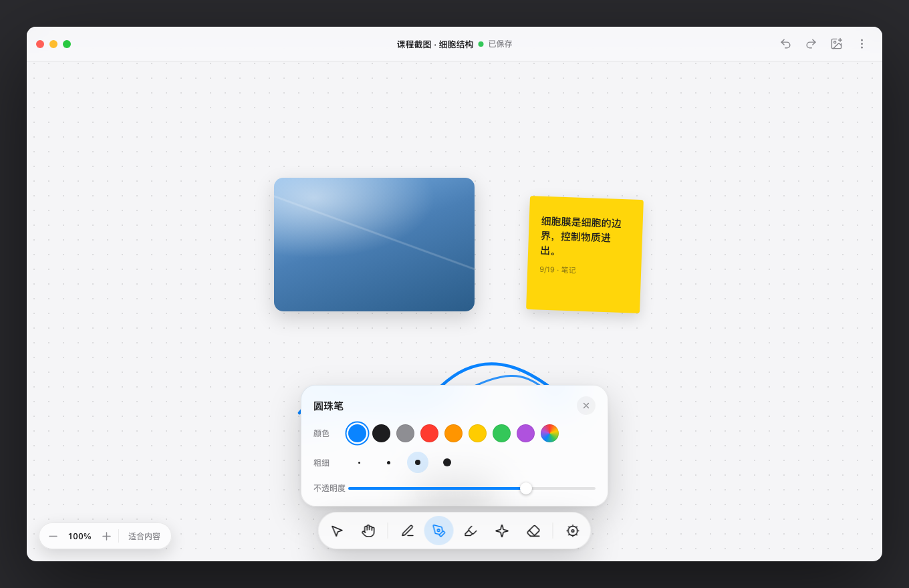

# 无限白板 · Infinite Whiteboard

在 Obsidian 中创建接近无边际的画板，把截图、照片和 Apple Pencil 手写批注整理在同一张画布上。

Infinite Whiteboard is a cross-platform infinite canvas for collecting screenshots, arranging visual material, and writing handwritten annotations with Obsidian.



Infinite Whiteboard 是一个面向桌面端和移动端的无限画布插件。它支持导入图片、自由手写、局部或整笔橡皮擦、框选与套索、多选变换、图层排序以及撤销重做，适合整理课程截图、会议记录、视觉素材和手写思考。

## 功能

- 无限画布：平移、缩放和适合内容。
- 截图整理：拖入、选择或粘贴图片，并支持裁剪、旋转和锁定。
- Apple Pencil 手写：圆珠笔、钢笔、荧光笔和激光笔。
- 压感与显示平滑：笔迹保存原始采样和不可变画笔快照。
- 精准擦除：局部擦除或整笔删除，单次手势可撤销。
- 选择与布局：矩形框选、自由套索、多选移动缩放、对齐与分布。
- 跨端使用：支持 Obsidian 的桌面端、iPad、iPhone 和 Android。
- 本地优先：插件不上传画板数据，不包含遥测或在线服务。

## 安装

通过 Obsidian Community 插件目录安装：

1. 打开 **设置 → 第三方插件**。
2. 关闭安全模式。
3. 选择 **浏览**，搜索 **Infinite Whiteboard**。
4. 安装并启用插件。

## 使用

1. 点击左侧功能区的钢笔图标，或从命令面板运行“新建无限画布”。
2. 在画布上书写、拖入图片或粘贴截图。
3. 使用底部文具工具栏切换笔、激光笔和橡皮擦。
4. 使用顶部操作栏撤销、重做、插入图片或缩放到适合内容。
5. 画板以 Vault 内的 `.board` 文件保存，可通过 Obsidian Sync 跨设备查看。

## 兼容性与数据

- 最低 Obsidian 版本：`1.5.0`。
- `.board` 当前使用 schema v5，并保留旧版画板的连续迁移路径。
- 图片以 Vault 相对路径引用，并保存在画板同名的 `.assets` 文件夹中。
- 插件不发送网络请求，不收集遥测。画板、附件和画笔偏好均保存在用户自己的 Vault 中。
- 当前不支持多人同时编辑同一画板；跨设备并行修改会保留冲突副本，避免静默覆盖。

## 开发

```bash
npm ci
npm run check
npm run dev
```

生产构建会生成 `manifest.json`、`main.js` 和 `styles.css`。官方发布使用与 Manifest `version` 完全一致的 Git 标签，并将这三个文件附加到 GitHub Release。

架构说明见 [ARCHITECTURE.md](./ARCHITECTURE.md)，完整版本记录见 [CHANGELOG.md](./CHANGELOG.md)。

## 作者

贤思齐

## 许可证

[MIT](./LICENSE)
